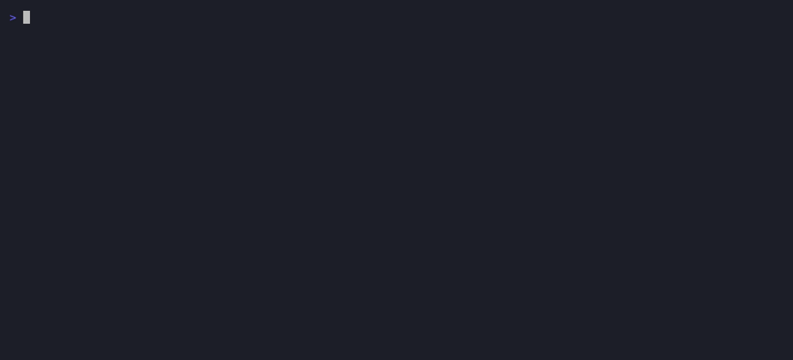

<div align="center">

# Laravel Orphan Files

Find the uploaded files your Laravel app no longer uses, and clean them up safely so they stop filling your disk and your S3 bill.

[](https://github.com/eramitgupta/laravel-orphan-files/blob/main/LICENSE.md)
[](https://packagist.org/packages/erag/laravel-orphan-files)
[](https://laravel.com)
[](https://www.php.net)
[](https://github.com/eramitgupta/laravel-orphan-files/actions/workflows/tests.yml)

[Documentation](https://erag.in/laravel-orphan-files/) · [Packagist](https://packagist.org/packages/erag/laravel-orphan-files)

</div>

## Why you need it

When a user changes their profile photo, deletes a post or removes a comment, the database moves on, but the old file stays in storage. Nothing uses it any more, yet it keeps taking space on your server and adds to your S3 bill every month. These leftover files are called orphaned files, and every app that accepts uploads collects them.

## What it does

Laravel Orphan Files finds those files for you. It looks at every file on the disks you choose, checks your database to see which files are still in use, and lists the ones nothing points to. You can then move them to a trash folder, restore them if you change your mind, or delete them for good.

It is careful by default:

- Nothing changes until you add `--force`, so the first run is always a preview.
- Cleaned files go to a trash folder you can restore from.
- Recent uploads are skipped (the last 24 hours by default), so a file that is still being saved is never removed.
- The clean stops if more than 90% of a disk looks unused (by default), because that usually means a config mistake.

It is just a few Artisan commands, with no migrations, no tables and no UI. It works with local disks, Amazon S3 and S3-compatible storage such as MinIO and RustFS, so it fits any app with profile photos, comment images, rich-text editors or product galleries.

In the demo below, a MinIO bucket holds 320 images (1.27 GB), and 160 of them (593 MB) are no longer used.

<p align="center">
  
</p>

## Installation

Install the package with Composer, then run the install command:

```bash
composer require erag/laravel-orphan-files
php artisan orphan:install
```

Laravel registers the package automatically. `orphan:install` creates `config/orphan-files.php`, where you list your disks and the columns that point to files, and prints the next steps. If the config file already exists, it asks before overwriting it; `--force` overwrites without asking. It never touches your database and creates no migrations. The [quick start](#quick-start) below shows a first setup.

## Features

- Works on any Laravel disk: `local`, `public`, Amazon S3 and S3-compatible storage, including MinIO and RustFS.
- Streams storage listings, so a bucket with millions of objects doesn't have to fit in memory.
- Reads file references from path columns, JSON columns, rich text (HTML or Markdown) and full URLs.
- Maps `Storage::url()` links, CDN URLs, S3, MinIO and RustFS endpoints and signed URLs back to disk paths.
- Lets you list columns in the config file, or declare them on a model with the `HasStorageFiles` trait.
- Keeps soft-deleted rows' files, because global scopes are ignored.
- Dry run by default: nothing changes until you add `--force`.
- Moves unused files to a trash folder with a 30 day retention, or deletes them (1,000 per request on S3).
- Restores trashed files to their original paths with one command.
- Skips recent uploads, excluded paths and anything outside your size or extension rules.
- Exports every orphan to CSV or prints the summary as JSON for monitoring.
- `orphan:explain` tells you why a single file is kept, or which column is missing.
- No migrations, no tables and no UI: just Artisan commands, queued jobs and events.

[See all features in the docs](https://erag.in/laravel-orphan-files/introduction.html)

## How it works

1. It lists the files in the disks and folders you configure, for example `avatars/` on the public disk.
2. It reads every column that can point to a file and compares those paths with the files on disk. Anything nobody references is an orphan.
3. It moves the orphans to a trash folder that keeps their original paths, so restoring a file is a single command. You can purge the trash later, or delete files directly if you prefer.

[Read the full walkthrough](https://erag.in/laravel-orphan-files/introduction.html)

## What it can read

- A path column holds one file, like `users.avatar` storing `avatars/jane.jpg`.
- A JSON column holds several files, like a comment's image gallery. You tell it which key holds the path.
- An HTML column is rich text, like a blog post body. Images and links are read from `src`, `href`, `srcset`, CSS `url()` and Markdown.
- A URL column stores a full link, like a product image served from a CDN or a signed S3 URL. The URL is turned back into the file's path on the disk.

You can add your own column types for editors like Editor.js. [See sources in the docs](https://erag.in/laravel-orphan-files/configuration/sources.html)

## Requirements

| Laravel | PHP |
| --- | --- |
| 12.x | 8.2, 8.3, 8.4 |
| 13.x | 8.3, 8.4 |

## Quick start

After installing, open `config/orphan-files.php` and tell it where files live and which columns point to them:

```php
'disks' => [
    'public' => ['avatars/'],
],

'sources' => [
    ['table' => 'users', 'column' => 'avatar', 'type' => 'path', 'disk' => 'public'],
],
```

Then scan, preview and clean:

```bash
php artisan orphan:scan            # how many orphans, and how much space they use
php artisan orphan:clean           # dry run: lists what would be trashed
php artisan orphan:clean --force   # moves the orphans to the trash
```

[Installation guide](https://erag.in/laravel-orphan-files/installation.html) · [Quick start](https://erag.in/laravel-orphan-files/quick-start.html)

## Commands

| Command | What it does |
| --- | --- |
| `orphan:install` | Publishes `config/orphan-files.php` and prints the next steps. Asks before overwriting; `--force` skips the question. |
| `orphan:scan` | Counts files, referenced files and orphans, and shows how much space you'd get back. Can export CSV or print JSON. |
| `orphan:clean` | Shows what would be cleaned. With `--force` it moves orphans to the trash, or deletes them with `--mode=delete`. |
| `orphan:restore` | Moves trashed files back to where they were, one file, one folder or everything. |
| `orphan:purge-trash` | Permanently deletes trash older than the retention period (30 days by default). |
| `orphan:explain` | Shows which rows reference a file, or why it counts as an orphan. |

[All command options and sample output](https://erag.in/laravel-orphan-files/commands/scan.html)

## Delete unused images in Laravel safely

Deleting files is easy to get wrong, so the package is careful by default:

- `orphan:clean` is a dry run until you add `--force`.
- Cleaned files go to a trash folder first. Permanent deletion is opt-in with `--mode=delete` or `orphan:purge-trash`.
- Files modified in the 24 hours before the database was read are skipped, so uploads whose row isn't saved yet stay put.
- If more than 90% of a disk would be cleaned, the clean stops. That ratio usually means a column is missing from the config.
- If a configured table or column doesn't exist, the command stops before it reads or touches anything.
- Only the folders you list are ever scanned.

[Running it safely](https://erag.in/laravel-orphan-files/guides/safety.html)

## Clean up orphaned files on S3, MinIO and RustFS

S3 disks work the same way as local ones, and so do S3-compatible stores such as MinIO and RustFS, because they all use Laravel's `s3` driver. Listings are paginated, so large buckets are fine, and deletes go out in batches of 1,000 keys. URLs stored in your database, including CDN domains and signed URLs, are matched back to the right object. [URLs and CDNs in the docs](https://erag.in/laravel-orphan-files/configuration/urls.html)

## FAQ

**How do I find unused files in Laravel storage?**
List your upload folders and the columns that store paths in `config/orphan-files.php`, then run `php artisan orphan:scan`.

**Will it delete files that are still in use?**
Not unless a column that references them is missing from your config. Run a scan first and check a few files with `orphan:explain`. Cleaned files go to a restorable trash by default.

**Can I undo a clean?**
Yes. `php artisan orphan:restore path/to/file` moves a trashed file back, and `--all` restores everything in the trash of every configured disk. Add `--disk=s3` to limit either one to a single disk.

**Does it work with Livewire or Inertia file uploads?**
Yes. It doesn't care how a file was uploaded. It only compares what's on the disk with the paths your database stores, and if you store them in an unusual format you can add a [custom extractor](https://erag.in/laravel-orphan-files/extending/extractors.html).

**Does it slow down my app?**
No. It only runs when you call a command or schedule one. It doesn't listen to model events and adds nothing to your requests.

**Can I run it on a schedule?**
Yes. Most people schedule a weekly scan first, then a weekly clean once the reports look right. [Scheduling](https://erag.in/laravel-orphan-files/guides/scheduling.html)

[More questions](https://erag.in/laravel-orphan-files/faq.html)

## Documentation

Full documentation, configuration options and examples: [Read the docs](https://erag.in/laravel-orphan-files/)

- [Installation](https://erag.in/laravel-orphan-files/installation.html)
- [Configuration](https://erag.in/laravel-orphan-files/configuration/disks.html)
- [Commands](https://erag.in/laravel-orphan-files/commands/scan.html)
- [Running it safely](https://erag.in/laravel-orphan-files/guides/safety.html)
- [Using it from code](https://erag.in/laravel-orphan-files/guides/code.html)
- [FAQ](https://erag.in/laravel-orphan-files/faq.html)

## Changelog and contributing

See the [changelog](CHANGELOG.md) for what changed. To help out, read [CONTRIBUTING.md](CONTRIBUTING.md) and use the [issues](https://github.com/eramitgupta/laravel-orphan-files/issues), [pull requests](https://github.com/eramitgupta/laravel-orphan-files/pulls) and [discussions](https://github.com/eramitgupta/laravel-orphan-files/discussions) on GitHub.

## Credits

Built and maintained by [Er Amit Gupta](https://github.com/eramitgupta).

## License

MIT. See [LICENSE.md](LICENSE.md).
